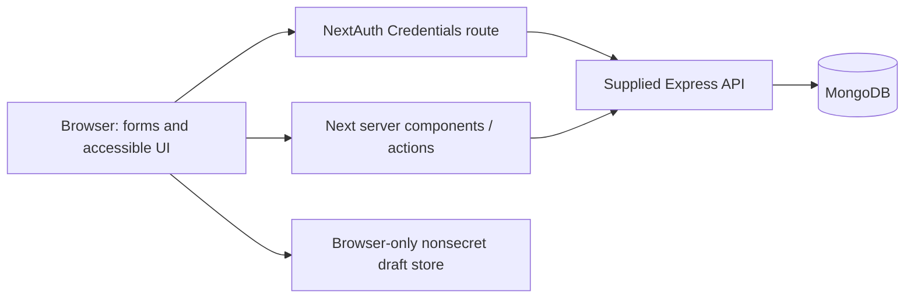

# Technical architecture

## Chosen baseline and compatibility gate

Next.js16 App Router, React version supported by chosen Next patch, TypeScript strict, ESLint, npm lockfile. Styling: CSS Modules plus semantic global custom properties; Tailwind is optional and should not become a competing token system. Course teaches both; do not install MUI merely to display a simple select/date field. Use accessible native controls first. NextAuth v4 Credentials as taught in W10; Redux Toolkit + React Redux + Redux Persist for a narrowly scoped nonsecret draft; Jest + React Testing Library + user-event; Cypress for E2E.

Before full scaffold, query official package metadata for Next16.x and next-auth4.24.15, supported Node/React peers, and test-library compatibility. Record installed exact versions and runtime in execution log; use lockfile and `npm ci`. Class03's16.3.0 is a teaching version, not a reason to force an unpublished/incompatible dependency. Smoke-test login, server session read, Server Action and build with selected pair; no `--legacy-peer-deps`, `--force`, `any` patches or security downgrades to conceal a mismatch. If compatibility fails, choose a supported same-family patch or document a consistent alternative and its course impact before proceeding. Do not blindly install latest across majors.

## Data boundaries



Server Components: page shells, initial catalog/detail, authenticated request/profile data, role-aware navigation. Client Components: search/filter controls, date/quantity forms, dialogs, session UI as needed, draft provider. Keep `use client` close to interactive leaves. Do not pass secrets or raw backend JWT through component props.

Server Actions: authenticated create/update/delete and registration forwarding. For each: parse/validate allowlisted input; obtain valid server-side credential; read `/auth/me` and enforce role; call exact upstream API; normalize errors; on success revalidate affected paths and return only serializable safe result. Backend independently rechecks ownership. Public search doesn't need Server Action; it filters fetched list. Never trust hidden user/equipment IDs without API validation. Avoid broad unauthenticated catch-all API proxies and client-selected upstream URLs.

## Authentication lifecycle

1. Credentials `authorize` sends email/password to backend `/auth/login` from server. On success preserve backend JWT and its expiry in NextAuth encrypted HttpOnly JWT cookie, user id/name/email/role as typed fields. Never copy passwords into returned user.
2. Use module augmentation for `User`, `JWT` and public `Session`; distinguish backend auth id vs model `_id`. Public session exposes minimal profile fields only, excluding backend token.
3. Since public `getServerSession()` result must not expose bearer JWT, implement one server-only credential helper using NextAuth v4's documented JWT decoding/token API against current request cookies (e.g. `getToken` with a verified request/header adapter supported by selected Next version). Validate this in the compatibility spike in route handlers AND Server Actions. Do not hand-roll cookie names/decryption or add bearer token to public session to make the helper easier. If the documented helper cannot operate reliably in the selected combination, record and implement a reviewed server-only token-vault alternative before proceeding.
4. Check backend expiry as well as frontend session validity. Set frontend maxAge no longer than backend token lifetime; handle backend401 regardless of cookie age. No refresh-token endpoint exists. Reauthenticate rather than invent refresh.
5. Each protected data operation must obtain credentials and check current `/auth/me`; deduplicate within a request when practical. Layout redirect alone is not authorization. JWT role in UI controls presentation; backend database role controls authority.
6. Registration: server action to backend, discard returned backend token, redirect to login success state as document04. No fake client session construction.
7. Logout: POST-based local action/UI invokes upstream GET `/auth/logout` using token where possible, then always clears NextAuth session and private/draft state; record upstream failure without preventing local logout. Do not expose a local destructive GET logout link. Multiple tabs should converge to logged-out state through session refetch/focus or a nonsecret broadcast event.
8. Login callback allowlist: same-origin relative app routes only; reject scheme/protocol-relative URLs and auth loops. Preserve selected equipment route. Anonymous access redirects login; wrong role403; never leak another user's request before checking.

This plan deliberately improves on teaching examples that expose `session.user.token`; note the adaptation in the report. No tokens, user lists, passwords or private request responses in browser persistence, analytics or screenshots.

## State and persistence

| Data | Owner | Lifetime |
|---|---|---|
| Equipment and rentals | API + server render | Fresh `no-store`; refresh on mutation |
| Identity/roles | NextAuth + backend me | Server validated; minimal public profile |
| Search/category/sort | URL search params | Shareable, back-button stable |
| Form errors/pending/dialog | Component state | Current screen |
| Unsaved new-request draft | Redux slice | equipmentId,quantity,date strings only |
| Draft persistence | Redux Persist sessionStorage | Per-tab session; clear success/logout/account change |

Create store per provider instance/request, not a process-global server singleton. Storage initialized browser-only with SSR-safe no-op fallback, hydration placeholder stable; do not gate entire server page behind PersistGate. Scope persisted draft to authenticated identity using an opaque client context, clear before another account uses it, revalidate dates/stock on restore. Persist version1 and a timestamp; discard stale drafts after24h or invalid schema. Never persist admin/edit forms or price estimates as authority. Redux demonstrates cross-screen drafts; it is not a cart and sending one request clears just that draft.

## Suggested source layout

```text
src/
  app/
    layout.tsx, page.tsx, globals.css, error.tsx, not-found.tsx
    equipment/page.tsx, equipment/[id]/page.tsx
    (auth)/login/page.tsx, (auth)/register/page.tsx
    (member)/requests/page.tsx, requests/new/page.tsx
    (member)/requests/[id]/page.tsx, requests/[id]/edit/page.tsx
    (account)/account/page.tsx
    admin/layout.tsx, admin/equipment/..., admin/requests/page.tsx
    api/auth/[...nextauth]/route.ts
  actions/auth.ts, equipment.ts, rentals.ts
  components/ui/, equipment/, requests/, admin/, layout/
  lib/api/server.ts, auth/options.ts, auth/credentials.ts
  lib/validation/, dates.ts, estimates.ts, assets.ts
  store/store.ts, draftSlice.ts, StoreProvider.tsx
  types/api.ts, next-auth.d.ts
public/images/, fonts/
__tests__/          # Jest, separate TS types
cypress/e2e/, fixtures/, support/, tsconfig.json
docs/              # Design and execution evidence
```

Route groups do not add URL segments. Do not create duplicate route trees that collide. The suggested `(member)` group must NOT impose a blanket member-only guard: S07/S08 also permit admins. Use a neutral `(authenticated)` name if clearer; protect the group for authentication, `/requests` and `/requests/new` specifically for members, and record detail/edit for owner OR admin. `[id]` param/searchParam APIs follow installed Next16 asynchronous conventions; verify docs. Page loading/error files near relevant segments. Use path alias `@/` consistently. Server-only modules import `server-only`; browser never imports upstream credential adapter.

## Runtime configuration and quality

Frontend `.env.example`: `BACKEND_URL=http://localhost:5000`, `NEXTAUTH_URL=http://localhost:3000`, `NEXTAUTH_SECRET=<generate locally>`. BACKEND_URL is origin without `/api/v1`; adapter appends it once. No MONGO_URI or backend JWT_SECRET in frontend; no NEXT_PUBLIC secret. Environment schema rejects missing values with useful server message. Use secure production cookies/HTTPS via library defaults; origin/CSRF protection for forms and handlers, no secrets in URLs. Backend configuration stays in separate backend checkout/service. Never reuse slide/sample secrets.

Semantic HTML, explicit image sizes, responsive image optimization, self-hosted font subset, no oversized autoplay hero. Public and authenticated mutable fetches explicitly no-store for initial delivery. Parallelize independent reads after auth is resolved; use loading/Suspense for real latency, no artificial timeout. Avoid CSS global element selectors that unexpectedly override component spacing; document cascade order. Handle long text and zero-price stock. Plain text descriptions, no dangerous HTML rendering.
